# CIVIC PULSE | Azure Data Engineering Pipeline

An end-to-end cloud data engineering portfolio project using **Microsoft Azure, Python, Polars, PostgreSQL, Azure Data Factory, Apache Airflow, Docker, and Terraform**.

**Status:** Core Pipeline Successfully Executed | Terraform Infrastructure Deployed | Further Enhancements Planned

**Cloud:** Microsoft Azure  
**Architecture:** Medallion Architecture (Bronze, Silver, Gold)  
**Domain:** Public Sector / Municipal Service Analytics

---

## 1. Project Overview

CIVIC PULSE is a cloud-based data engineering project designed to transform raw municipal service request data into structured, analysis-ready datasets.

Public service agencies handle large volumes of requests relating to infrastructure, sanitation, environmental concerns, and community services. Processing this data reliably can help agencies understand service demand, monitor operational performance, identify backlogs, and support resource allocation.

This project demonstrates the implementation of a Medallion Architecture using Azure Blob Storage, Python, Polars, Azure Data Factory, and Azure Database for PostgreSQL.

The following components have been successfully implemented:

- Bronze-layer data ingestion using Python and Azure Blob Storage.
- Silver-layer transformation using Python and Polars.
- PostgreSQL Gold-layer schema and table creation.
- Azure Data Factory Silver-to-Gold data movement.
- Apache Airflow workflow orchestration using Docker and Astronomer Astro CLI.
- Infrastructure provisioning using Terraform and the AzureRM provider.

The Azure Data Factory Copy activity successfully reported **654,156 records read and written**.

A four-task Apache Airflow DAG also completed successfully, coordinating ingestion, transformation, PostgreSQL table preparation, and Azure Data Factory execution.

Additionally, a separate Terraform deployment demonstrates Infrastructure as Code by provisioning Azure Storage, PostgreSQL, Azure Data Factory, a linked service, and a Parquet dataset.

Further development will focus on independent data quality validation, monitoring, SQL analytics, and reporting.

---

## 2. Project Objectives

- Build an end-to-end cloud data engineering pipeline.
- Ingest municipal service request data into Azure Blob Storage.
- Transform raw CSV data into Parquet using Python and Polars.
- Organise data using Bronze, Silver, and Gold layers.
- Load transformed records into Azure Database for PostgreSQL.
- Automate data movement using Azure Data Factory.
- Orchestrate the pipeline using Apache Airflow.
- Implement task dependencies and scheduled execution.
- Demonstrate Infrastructure as Code using Terraform.
- Validate pipeline execution and document implementation evidence.
- Explore future reporting and analytical use cases.

---

## 3. Technology Stack

| Technology | Purpose |
|---|---|
| Microsoft Azure | Cloud infrastructure |
| Terraform | Infrastructure as Code |
| AzureRM Provider | Azure resource provisioning |
| Azure Blob Storage | Bronze and Silver storage |
| Python | Data ingestion and transformation |
| Azure Storage SDK | Programmatic blob uploads |
| Polars | Data transformation |
| Apache Parquet | Columnar data format |
| Azure Data Factory | Silver-to-Gold data movement |
| Azure Database for PostgreSQL | Gold-layer database |
| PostgreSQL and pgAdmin | SQL development and verification |
| Apache Airflow | Workflow orchestration |
| Astronomer Astro CLI | Local Airflow development |
| Docker | Local Airflow containers |
| Git and GitHub | Version control |
| VS Code | Development environment |

---

## 4. Data Architecture

The solution follows a three-layer Medallion Architecture.

### Operational Data Pipeline

```text
Municipal Service Request Dataset (CSV)
                  |
                  v
        Python Ingestion Script
                  |
                  v
       Azure Blob Storage: BRONZE
       urban_service_requests.csv
                  |
                  v
             Python + Polars
       Data Cleaning / Transformation
                  |
                  v
       Azure Blob Storage: SILVER
      urban_service_requests.parquet
                  |
                  v
           Azure Data Factory
             Copy Activity
                  |
                  v
       Azure Database for PostgreSQL
          GOLD Schema / Table
                  |
                  v
        Future SQL Analytics
             and Reporting
```

### Apache Airflow Orchestration

Apache Airflow coordinates the pipeline stages through a DAG named `urban_city_requests`.

```text
          Apache Airflow DAG
          urban_city_requests
                   |
                   v
         extract_data_from_api
            Python Ingestion
                   |
                   v
          transform_data_task
           Polars Transformation
                   |
                   v
            urban_city_table
        PostgreSQL Schema / Table
                   |
                   v
            run_data_factory
         Azure Data Factory Pipeline
                   |
                   v
            PostgreSQL Gold
```

The DAG is configured with an hourly schedule, sequential task dependencies, and retry settings.

### Terraform Infrastructure as Code

A separate Terraform implementation demonstrates Azure infrastructure provisioning.

```text
              Terraform
                  |
                  v
          Azure Resource Group
                  |
       +----------+----------+
       |          |          |
       v          v          v
     Azure     PostgreSQL   Azure
    Storage    Flexible     Data
    Account     Server     Factory
       |          |          |
    +--+--+       v          v
    |     |    Database    Blob Storage
  Bronze Silver            Linked Service
                              |
                              v
                         Parquet Dataset
```

**Important:** The Terraform deployment is separate from the original operational data pipeline. It demonstrates infrastructure provisioning rather than recreating the entire existing pipeline.

### Bronze Layer

Stores the raw CSV dataset in Azure Blob Storage.

**Object:** `bronze/urban_service_requests.csv`

### Silver Layer

Stores selected and standardised fields in a Snappy-compressed Parquet dataset.

**Object:** `silver/urban_service_requests.parquet`

### Gold Layer

Stores transformed records in Azure Database for PostgreSQL for SQL queries and future analytical workloads.

**Database:** `urban_city_db`  
**Schema:** `gold`  
**Table:** `urban_city_requests`

---

## 5. Implementation and Visual Evidence

The following sections document each stage of the implementation. Screenshots are embedded beneath the relevant explanations to demonstrate the work performed and the resulting output.

### Phase 1: Development Environment Setup

**Status: Completed**

The project began with local environment configuration on macOS, including:

- Cloning the GitHub repository.
- Creating and activating a Python virtual environment.
- Configuring VS Code.
- Installing the required Python dependencies.
- Preparing the repository structure and Git configuration.

#### PostgreSQL Server Reference

The PostgreSQL environment was reviewed as part of the database setup and learning process.

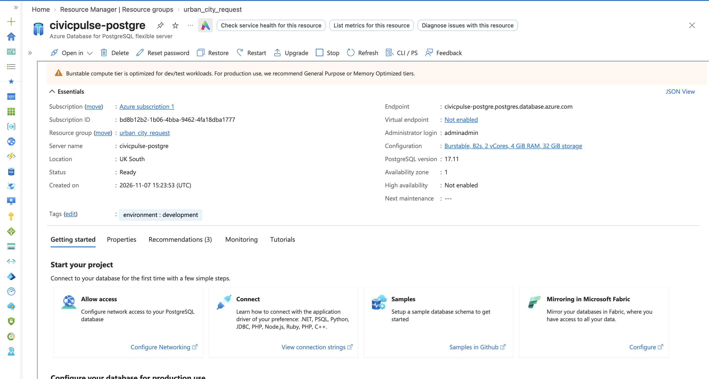

#### Project Directory Structure

The project separates scripts, documentation, and screenshots. Local datasets, environment files, and secrets are excluded from version control.

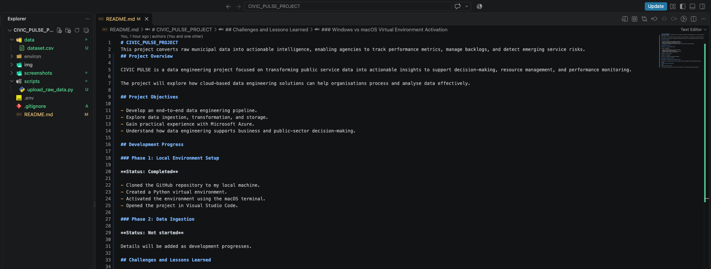

### Phase 2: Azure Storage Provisioning

**Status: Completed**

Provisioned an Azure Storage Account and configured containers to support the Bronze and Silver stages of the pipeline.

The storage design separates raw input data from transformed output data, allowing each stage to be managed and validated independently.

#### Azure Storage Account

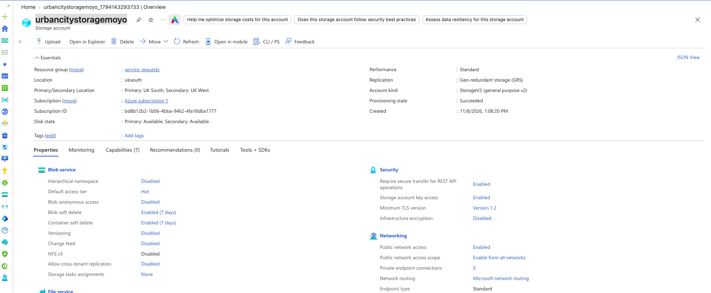

### Phase 3: Data Ingestion into Bronze

**Status: Completed**

Developed the Python ingestion script:

`include/upload_raw_data.py`

The script uses the Azure Blob Storage SDK to read the source CSV from the local development environment and upload it into the Bronze container.

The ingestion function is also used by the Apache Airflow DAG.

#### Successful Python Upload

The terminal output confirmed that the source file was uploaded successfully.

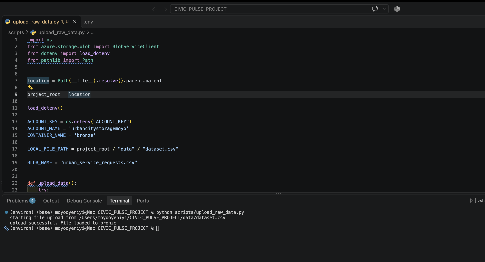

#### Bronze Layer Verification

Verified that the uploaded dataset was present in Azure Blob Storage.

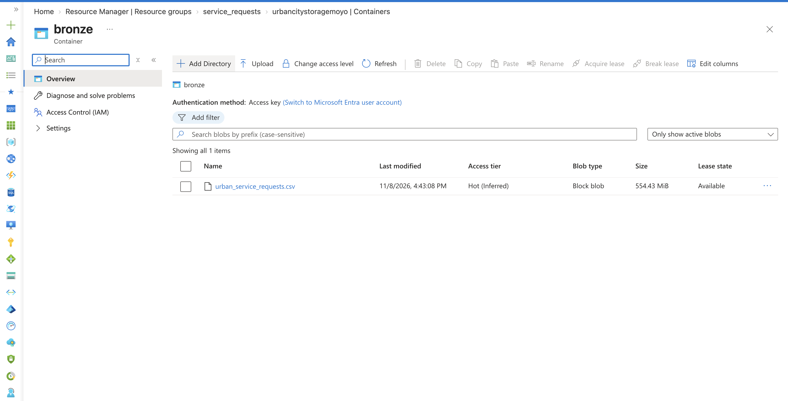

#### Version Control

Used Git to track project changes and publish the implementation to GitHub.

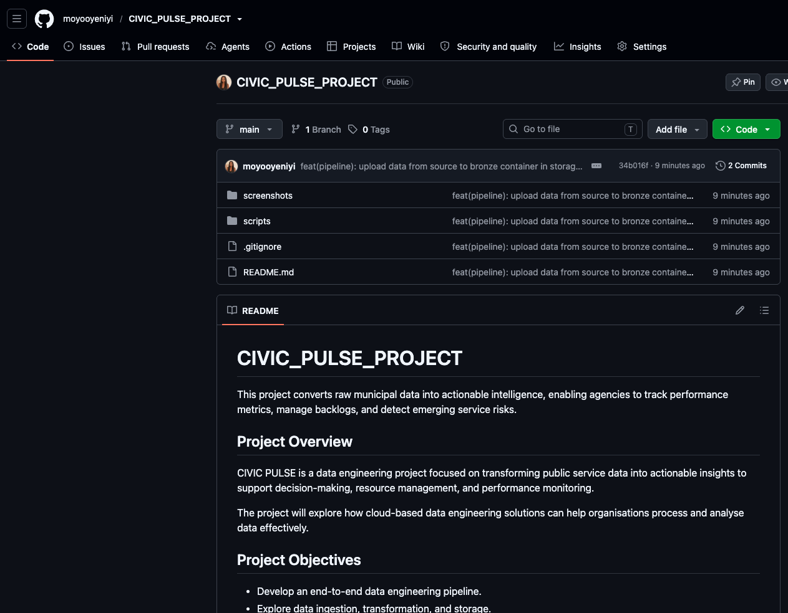

### Phase 4: Data Transformation into Silver

**Status: Completed**

Developed the transformation script:

`include/transform.py`

The script uses Polars to process the source CSV dataset.

Transformation operations include:

- Selecting relevant service request fields.
- Standardising column names to snake_case.
- Writing the selected data into Parquet format.
- Applying Snappy compression.
- Uploading the transformed dataset to the Silver container.

Selected fields include request creation and closure dates, problem classifications, location details, borough, latitude, and longitude.

The transformation function is integrated into the Apache Airflow DAG.

#### Successful Python Transformation

The transformation script completed successfully and wrote the Parquet dataset to Azure Blob Storage.

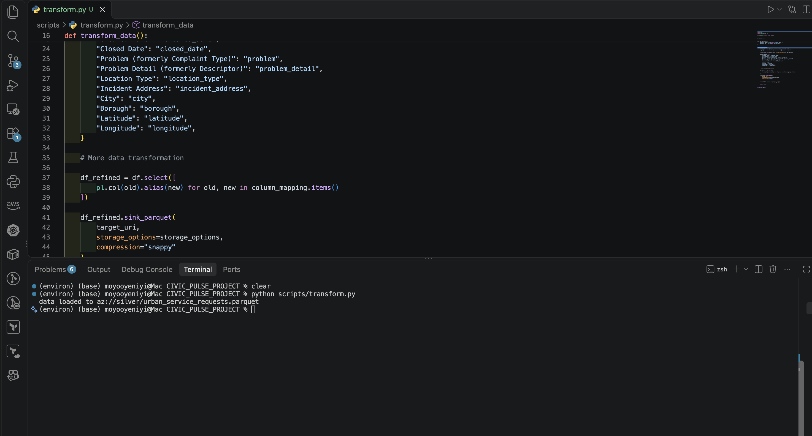

#### Silver Layer Verification

Verified that the transformed Parquet file was available in the Silver container.

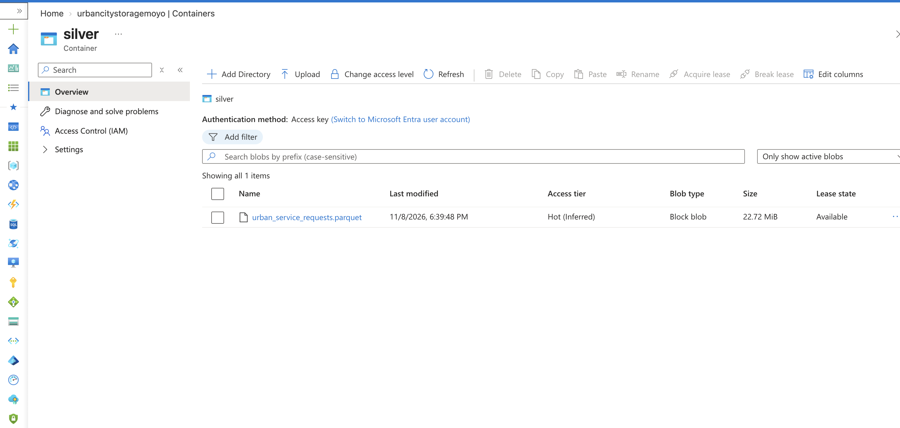

### Phase 5: PostgreSQL Gold Layer

**Status: Completed**

Provisioned Azure Database for PostgreSQL and connected to the database using pgAdmin.

Created the `gold` schema and `gold.urban_city_requests` table to receive transformed service request records.

The destination table includes:

| Column | PostgreSQL Type |
|---|---|
| created_date | TIMESTAMP |
| closed_date | TIMESTAMP |
| problem | TEXT |
| problem_detail | TEXT |
| location_type | VARCHAR(100) |
| incident_address | TEXT |
| city | VARCHAR(100) |
| borough | VARCHAR(100) |
| latitude | DOUBLE PRECISION |
| longitude | DOUBLE PRECISION |

The schema and table definition are also maintained in:

`dags/sql/urban_city.sql`

Apache Airflow executes this SQL file through `SQLExecuteQueryOperator`, allowing the required Gold-layer schema and table to be created if they do not already exist.

#### Gold Table Creation

Created the destination schema and table using SQL.

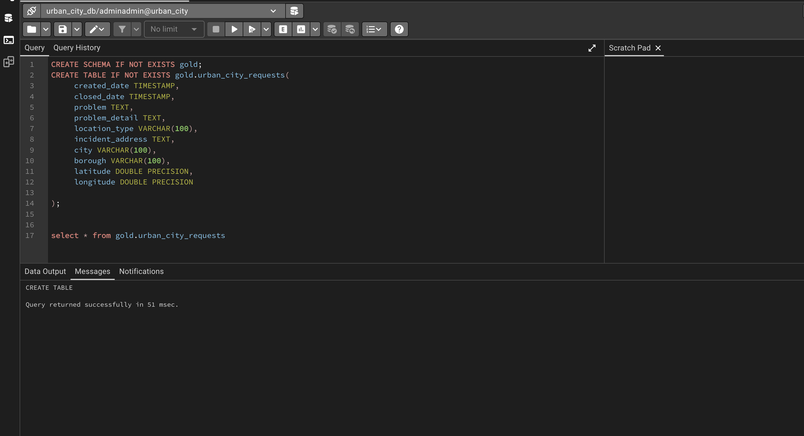

#### Gold Table Verification

Verified the destination table structure in PostgreSQL.

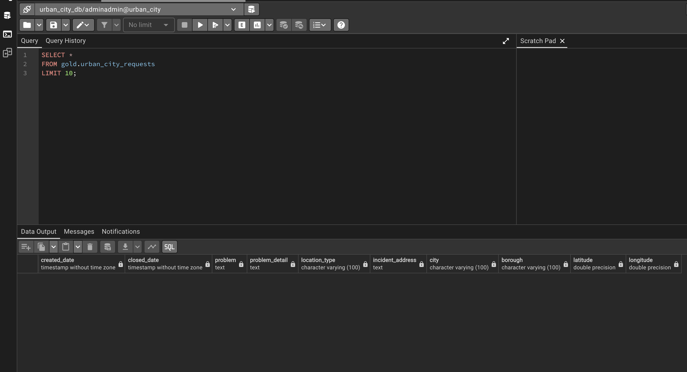

#### Gold Data Verification

Reviewed the destination database using pgAdmin.

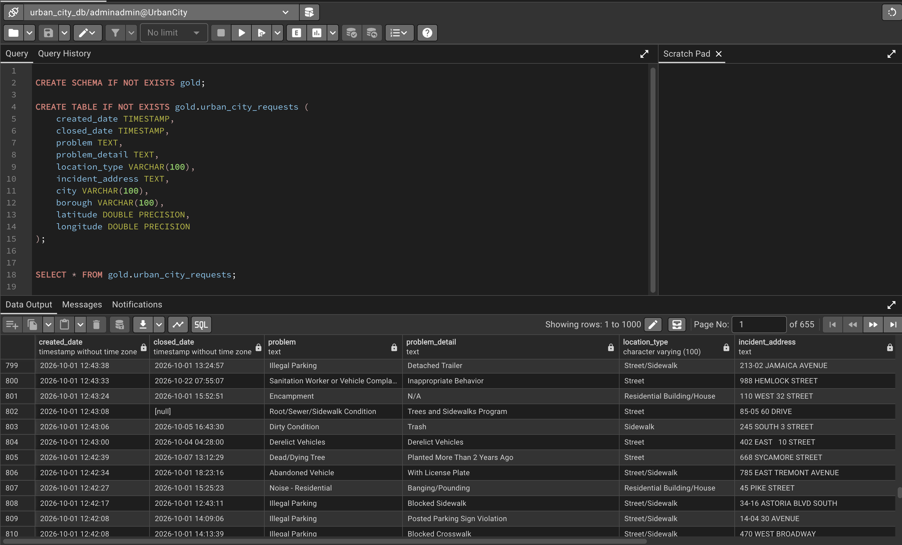

### Phase 6: Azure Data Factory Silver-to-Gold Pipeline

**Status: Completed**

Created an Azure Data Factory pipeline named:

`UrbanCityDataFactoryPipeline`

Configured linked services and datasets for Azure Blob Storage and Azure Database for PostgreSQL.

The Copy activity, `SilverToGoldPipeline`, reads the transformed Parquet file and writes records into the Gold-layer PostgreSQL table.

The Azure Data Factory pipeline is also integrated into Apache Airflow through `AzureDataFactoryRunPipelineOperator`.

#### Successful Pipeline Execution

The Azure Data Factory monitoring interface reported a successful pipeline run.

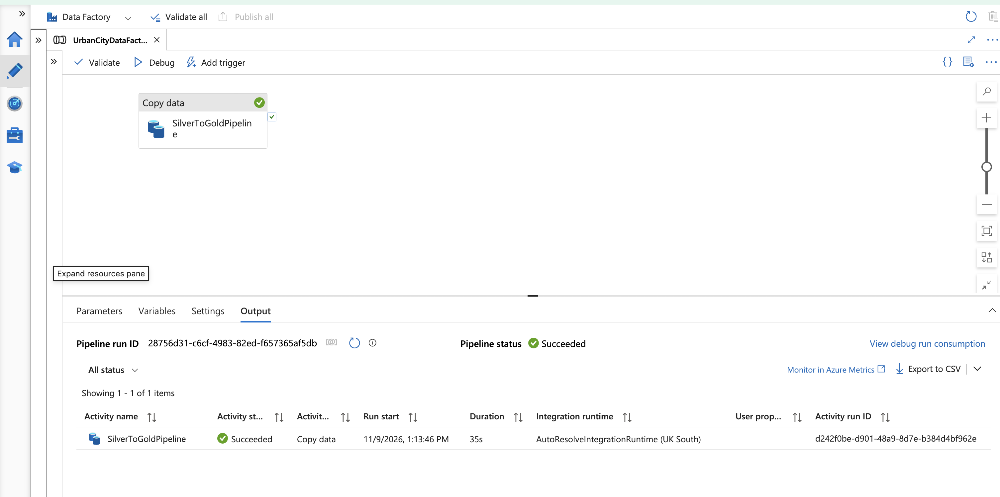

#### Copy Activity Performance

The Copy activity produced the following results:

| Metric | Result |
|---|---|
| Execution status | Succeeded |
| Source | Azure Blob Storage |
| Destination | Azure Database for PostgreSQL |
| Files read | 1 |
| Rows read | 654,156 |
| Rows written | 654,156 |
| Source data read | 347.295 MB |
| Destination data written | 123.627 MB |
| Copy duration | 30 seconds |
| Reported throughput | 15.1 MB/s |

The activity reported matching source and destination row counts. Independent data consistency verification was not enabled for this execution.

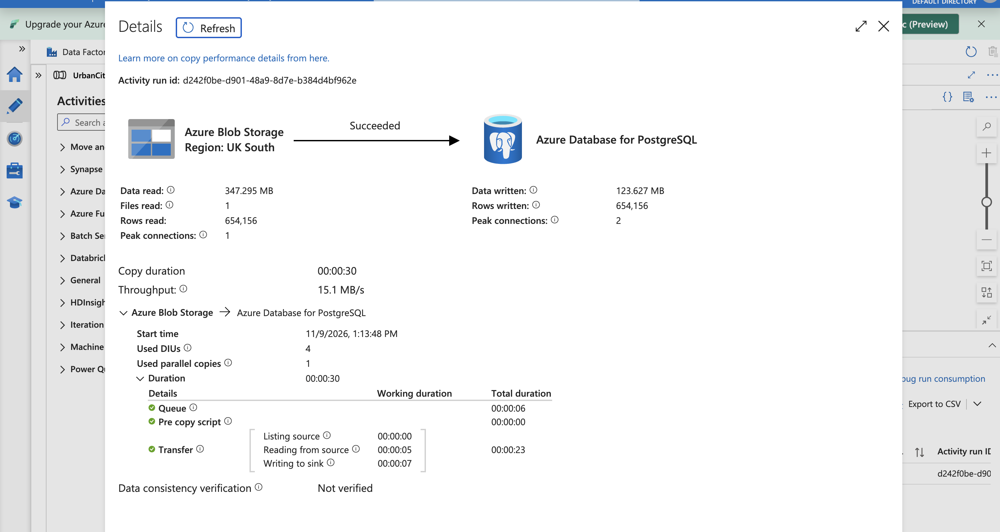

### Phase 7: Apache Airflow Local Environment

**Status: Completed**

Installed Astronomer Astro CLI using Homebrew and updated the CLI to version 1.47.0.

Used Astro CLI and Docker to start Apache Airflow locally.

#### Astro CLI Startup

The local environment was started successfully using the Astro CLI.

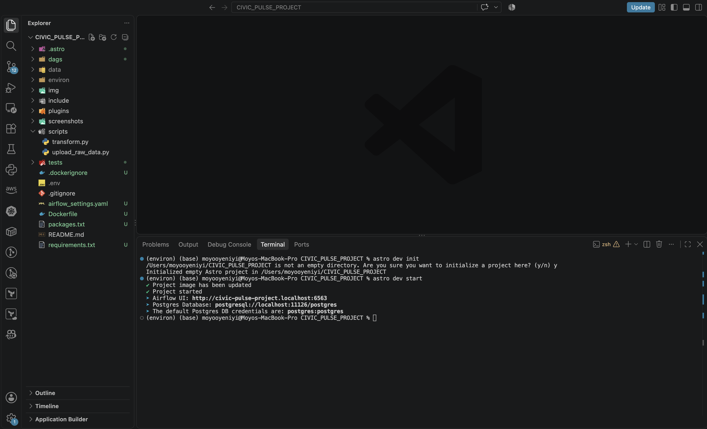

#### Apache Airflow Dashboard

Accessed the Airflow web interface and confirmed that the metadata database, scheduler, triggerer, and DAG processor were healthy.

At this initial stage, no project DAGs had been configured.

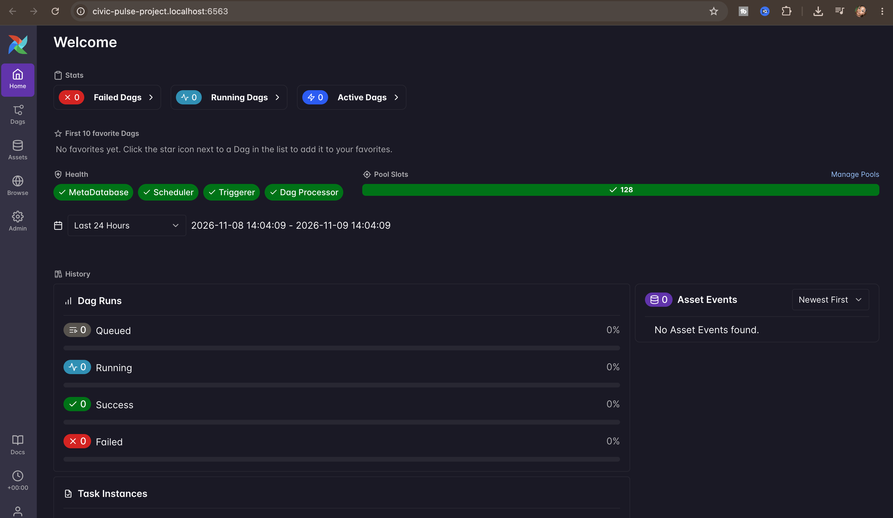

### Phase 8: Apache Airflow DAG Orchestration

**Status: Implemented and successfully executed**

Developed an Apache Airflow DAG named:

`urban_city_requests`

The DAG is defined in:

`dags/urban_city.py`

The workflow integrates Python ingestion, Polars transformation, PostgreSQL table creation, and Azure Data Factory execution.

#### DAG Configuration

The DAG includes:

- An hourly execution schedule using `@hourly`.
- A defined workflow start date.
- Disabled catchup for historical scheduled runs.
- Task retries and retry delays.
- Sequential task dependencies.
- Azure Data Factory integration.
- PostgreSQL SQL execution.

#### Airflow Tasks

The DAG contains four tasks.

| Task | Function | Technology |
|---|---|---|
| `extract_data_from_api` | Upload source CSV to Bronze | Python, Azure Blob Storage |
| `transform_data_task` | Transform data and write Silver Parquet | Python, Polars |
| `urban_city_table` | Create Gold schema and table | PostgreSQL, SQLExecuteQueryOperator |
| `run_data_factory` | Trigger the Silver-to-Gold pipeline | Azure Data Factory |

#### Task 1: Data Ingestion

The `extract_data_from_api` task calls the `upload_data()` function from:

`include/upload_raw_data.py`

This uploads the source municipal service request dataset to Azure Blob Storage Bronze.

#### Task 2: Data Transformation

The `transform_data_task` task calls the `transform_data()` function from:

`include/transform.py`

The transformation processes the source data using Polars and writes the resulting Parquet file into Azure Blob Storage Silver.

#### Task 3: PostgreSQL Table Creation

The `urban_city_table` task uses `SQLExecuteQueryOperator`.

It executes:

`dags/sql/urban_city.sql`

The SQL script creates the `gold` schema and `gold.urban_city_requests` table if they do not already exist.

This task uses the configured Airflow PostgreSQL connection:

`postgres_conn`

#### Task 4: Azure Data Factory Execution

The `run_data_factory` task uses `AzureDataFactoryRunPipelineOperator`.

It triggers the Azure Data Factory pipeline:

`UrbanCityDataFactoryPipeline`

The pipeline handles the movement of transformed Silver-layer data into the PostgreSQL Gold layer.

#### Task Dependencies

The four tasks execute sequentially:

```text
extract_data_from_api
        |
        v
transform_data_task
        |
        v
urban_city_table
        |
        v
run_data_factory
```

This ensures that the ingestion stage precedes transformation, the destination table is prepared, and the Azure Data Factory pipeline is triggered afterward.

#### Airflow DAG Registration

The `urban_city_requests` DAG was successfully registered in the local Apache Airflow interface.

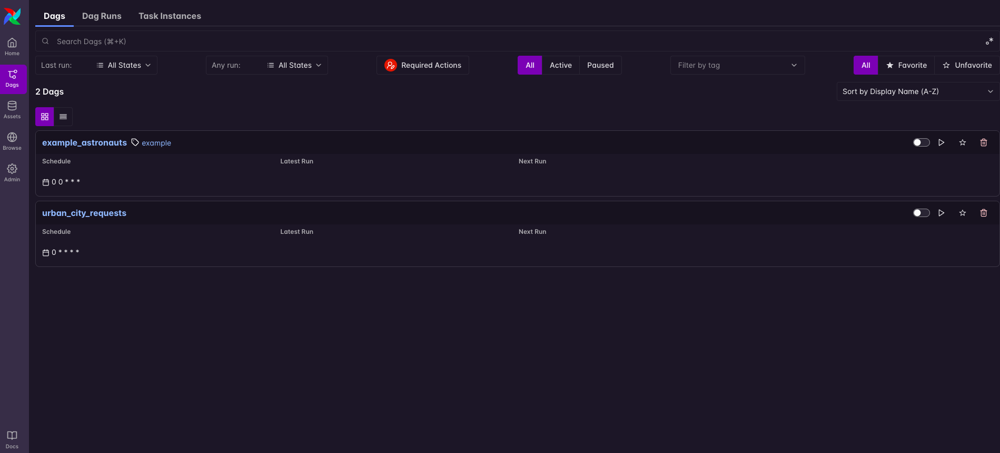

#### Bronze-to-Silver Task Execution

The ingestion and transformation tasks were executed successfully in Apache Airflow.

This demonstrated that the existing Python functions could be integrated into an orchestrated workflow.


#### Silver Parquet Verification

Verified that the transformed Parquet dataset was available in Azure Blob Storage following the transformation stage.

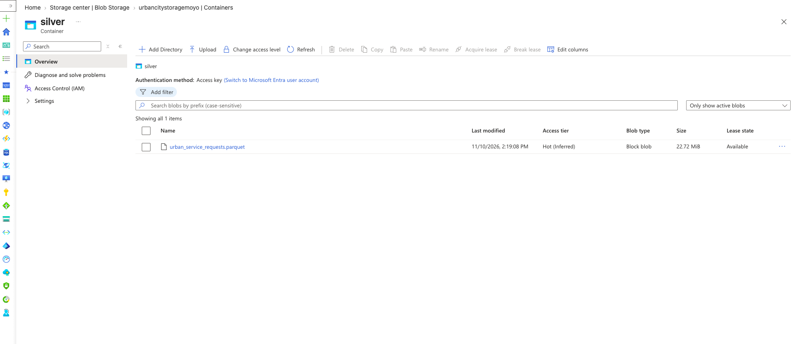

#### Complete Airflow Pipeline Execution

The full four-task Airflow DAG was executed successfully.

The Airflow interface displayed successful task states for:

- `extract_data_from_api`
- `transform_data_task`
- `urban_city_table`
- `run_data_factory`

This demonstrates successful workflow execution across Python ingestion, Polars transformation, PostgreSQL SQL execution, and Azure Data Factory triggering.

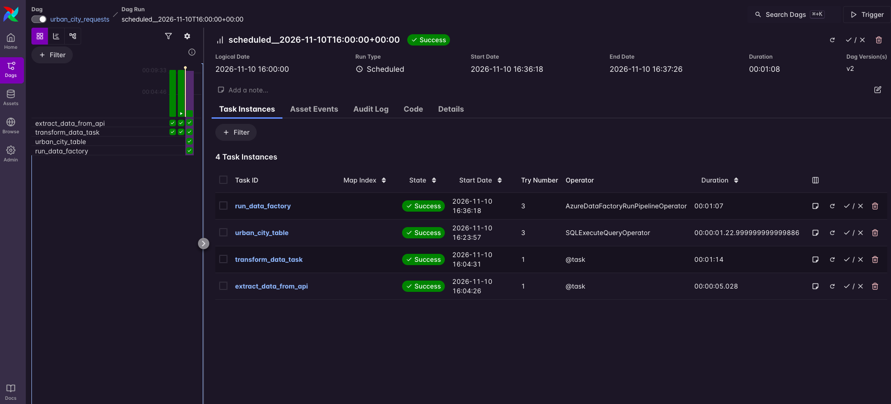

The successful Airflow run confirms task execution. Independent verification of Gold-layer row counts following the latest orchestrated run remains a follow-up validation step.

### Phase 9: Terraform Infrastructure as Code

**Status: Completed (Separate Infrastructure Deployment)**

To extend the project beyond data engineering and demonstrate cloud infrastructure automation, I implemented a separate Azure infrastructure deployment using Terraform.

The objective was to practise provisioning, configuring, and managing cloud resources declaratively rather than relying entirely on manual configuration through the Azure Portal.

The Terraform configuration is maintained in:

`terraform/main.tf`

A PostgreSQL password input variable is declared in:

`terraform/variables.tf`

This implementation demonstrates infrastructure provisioning without claiming that the original operational data pipeline was created entirely using Terraform.

#### Infrastructure Provisioned

| Azure Resource | Purpose |
|---|---|
| Resource Group (`urban-city-rgg`) | Organises project infrastructure |
| Storage Account (`urbancitystoragemoyo2`) | Provides cloud object storage |
| Bronze Container | Raw data storage |
| Silver Container | Transformed data storage |
| PostgreSQL Flexible Server (`urbancitypgserver`) | Managed relational database infrastructure |
| PostgreSQL Database (`urban_city_db`) | Database for structured data |
| Azure Data Factory (`urbancityfactorymoyo2026`) | Data integration service |
| Blob Storage Linked Service (`blob_storage_ls`) | Connects Data Factory to Azure Storage |
| Parquet Dataset (`urban_city_parquet_ds`) | Defines the Silver-layer Parquet dataset |

#### Terraform Implementation

The configuration uses the AzureRM provider and resource references to establish dependencies between infrastructure components.

The implementation demonstrates:

- Declarative infrastructure provisioning using HCL.
- Azure resource configuration and management.
- Terraform provider configuration.
- Resource dependencies and references.
- Input variables for sensitive configuration.
- Terraform validation and execution planning.
- Infrastructure deployment using `terraform apply`.
- Verification of deployed resources in the Azure Portal.

#### Terraform Configuration

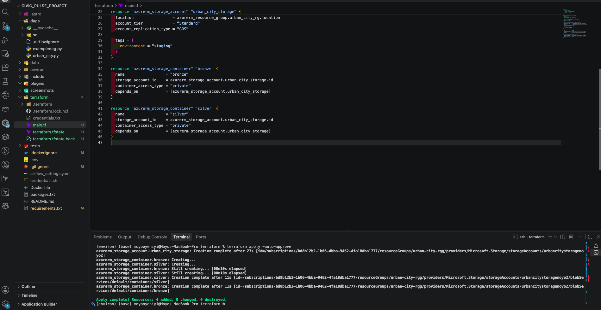

#### Terraform Validation

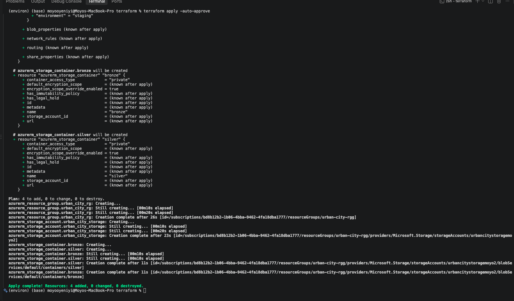

#### Azure Infrastructure Deployment

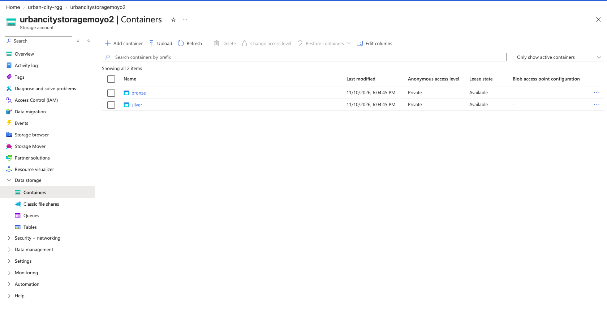

#### PostgreSQL Deployment

Provisioned an Azure PostgreSQL Flexible Server and database using Terraform.

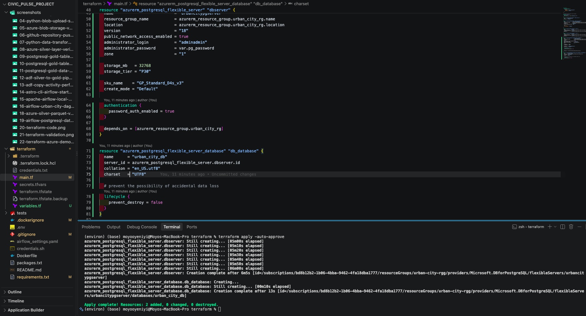

#### PostgreSQL Flexible Server Verification

Verified the PostgreSQL Flexible Server in the Azure Portal.

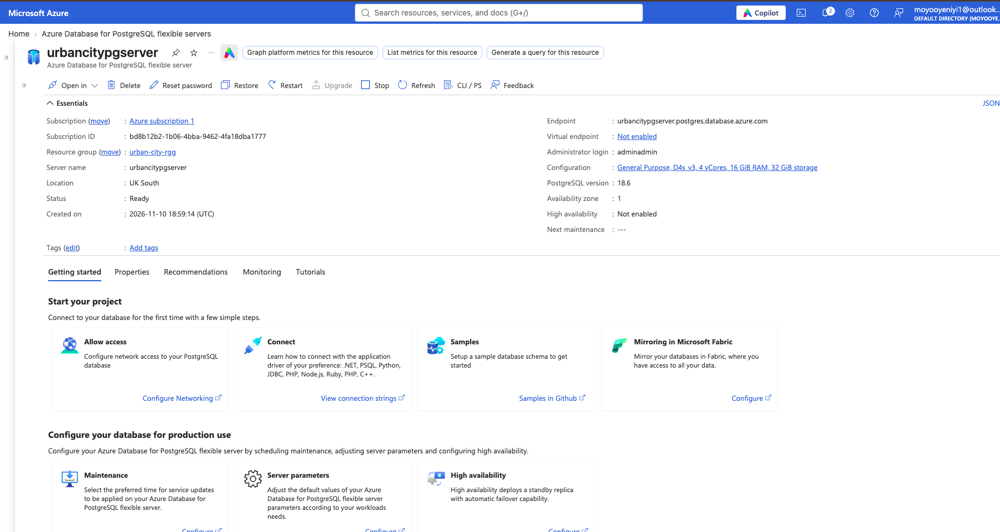

#### Azure Data Factory Deployment

Provisioned Azure Data Factory, an Azure Blob Storage linked service, and a Parquet dataset using Terraform.

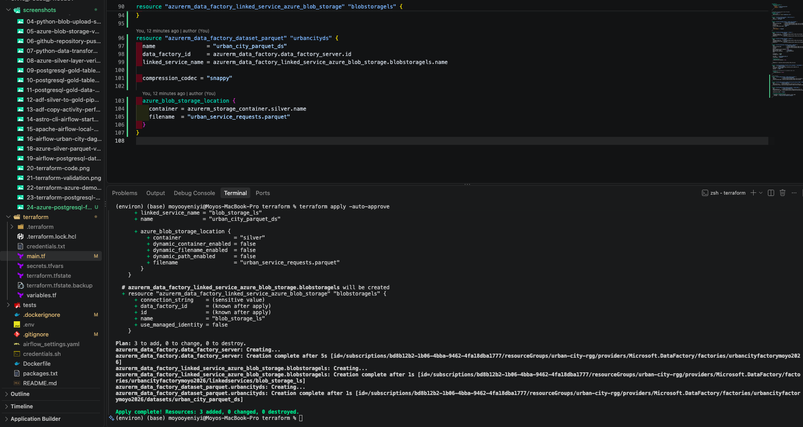

#### Azure Data Factory Overview

Verified that the new Data Factory resource was created.

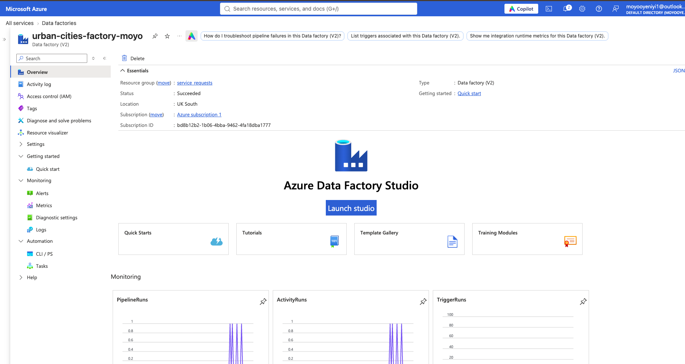

#### Azure Blob Storage Linked Service

The linked service `blob_storage_ls` was created through Terraform and verified in Azure Data Factory Studio.

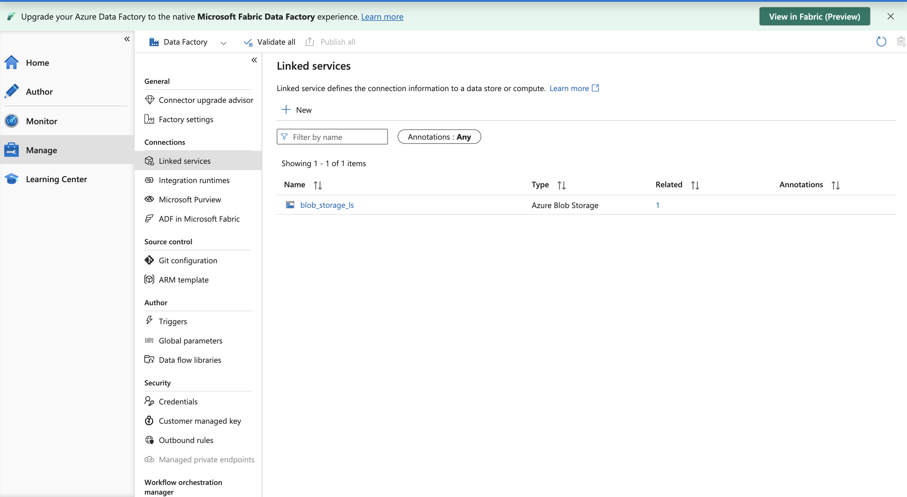

#### Parquet Dataset Configuration

The dataset `urban_city_parquet_ds` was created with the following configuration:

| Property | Configuration |
|---|---|
| Linked service | `blob_storage_ls` |
| Container | `silver` |
| Filename | `urban_service_requests.parquet` |
| Compression | Snappy |

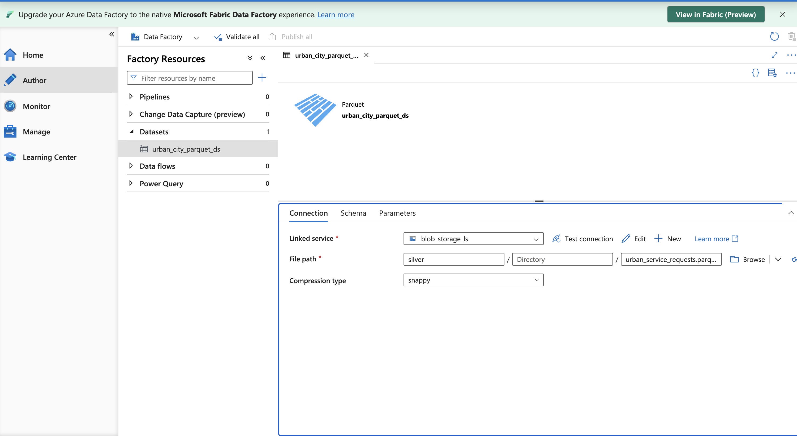

#### Terraform Deployment Scope

The Terraform deployment is a separate Infrastructure as Code demonstration.

It demonstrates infrastructure provisioning and configuration but does not recreate or execute the complete original data pipeline.

The Terraform-managed Parquet dataset defines a storage location. Its creation alone does not confirm that the referenced file has been uploaded to the separate Storage Account.

---

## 6. Challenges and Lessons Learned

### Cross-Platform Python Environments

Learned that Python virtual environment activation commands differ between operating systems.

**Windows PowerShell:**

```powershell
.\environ\Scripts\Activate.ps1
```

**macOS / Linux:**

```bash
source environ/bin/activate
```

### Python Debugging

Encountered and resolved indentation errors, inconsistent function names, and unsupported arguments while developing ingestion and transformation scripts.

This strengthened my understanding of Python debugging and library APIs.

### Azure Blob Storage Integration

Learned how to organise cloud storage containers, configure application access, upload files programmatically, and verify stored datasets.

### PostgreSQL Network Connectivity

Troubleshot connectivity problems caused by network restrictions and PostgreSQL firewall configuration.

Resolved the issue by adjusting the network connection and permitted client IP address.

### Azure Data Factory Configuration

Encountered a PostgreSQL relation resolution error while configuring the destination dataset.

Corrected the destination schema and table mapping, then successfully executed the Copy activity.

### Apache Airflow DAG Development

Learned how to define DAGs, configure schedules, create Python tasks, and manage dependencies using Apache Airflow.

Integrated existing ingestion and transformation functions into the Airflow workflow.

### Airflow Provider Integration

Worked with Apache Airflow provider operators to integrate PostgreSQL and Azure Data Factory.

Used `SQLExecuteQueryOperator` for SQL execution and `AzureDataFactoryRunPipelineOperator` for Azure Data Factory orchestration.

### Local Docker-Based Orchestration

Used Astronomer Astro CLI and Docker to run Apache Airflow locally.

Gained experience working with containerised orchestration services and understanding differences between local development paths and container file paths.

### Pipeline Validation

Used Azure Data Factory execution metrics and Airflow task states to inspect pipeline execution.

The experience highlighted the difference between successful task execution and independently verifying data completeness and quality.

### Terraform Configuration and Deployment

During the Terraform implementation, I encountered a duplicate variable declaration and resolved it by maintaining the PostgreSQL password variable in `variables.tf`.

I also encountered a `DataFactoryNameInUse` error because the requested Azure Data Factory name was unavailable.

I resolved the issue by selecting a different globally unique Data Factory name and reviewing the Terraform execution plan before deployment.

This strengthened my understanding of:

- Terraform configuration organisation.
- Azure resource naming requirements.
- Terraform validation and execution planning.
- Resource dependencies.
- Infrastructure troubleshooting.
- Azure infrastructure deployment.

---

## 7. Next Steps

- Verify Gold-layer row counts following the latest Airflow-triggered pipeline run.
- Add automated data quality checks and independent row-count validation.
- Improve monitoring, logging, and error handling.
- Explore more advanced Airflow scheduling and orchestration practices.
- Develop SQL queries for operational analysis.
- Explore analytical reporting and visualisation.
- Implement Terraform remote state management.
- Explore infrastructure CI/CD using GitHub Actions.
- Improve infrastructure security and access controls.
- Explore integrating Terraform-managed infrastructure with a reproducible data pipeline.

---

## 8. Skills Demonstrated

- Microsoft Azure cloud infrastructure.
- Azure Blob Storage.
- Python scripting and debugging.
- Polars data transformation.
- CSV-to-Parquet processing.
- Medallion Architecture.
- Azure Data Factory pipeline development.
- Azure Database for PostgreSQL.
- SQL schema and table creation.
- Apache Airflow DAG development.
- Apache Airflow task dependencies and scheduling.
- Apache Airflow provider operators.
- Azure Data Factory orchestration.
- Docker-based development.
- Astronomer Astro CLI.
- Cloud connectivity troubleshooting.
- Pipeline monitoring and execution validation.
- Terraform and HashiCorp Configuration Language (HCL).
- AzureRM provider configuration.
- Infrastructure as Code.
- Azure resource dependency management.
- Terraform validation, planning, and deployment.
- Git and GitHub version control.
- Technical documentation and implementation evidence.

---

## 9. Project Status

**CIVIC PULSE is an active cloud and data engineering portfolio project.**

The core data pipeline has been implemented and successfully executed. Terraform infrastructure provisioning has also been completed as a separate demonstration.

| Component | Status |
|---|---|
| Development environment | Completed |
| Azure Storage provisioning | Completed |
| Bronze data ingestion | Completed |
| Silver data transformation | Completed |
| PostgreSQL Gold schema and table | Completed |
| Azure Data Factory Silver-to-Gold pipeline | Successfully executed |
| Apache Airflow local environment | Completed |
| Apache Airflow DAG registration | Completed |
| Airflow Bronze-to-Silver orchestration | Successfully executed |
| Airflow PostgreSQL integration | Successfully executed |
| Airflow Azure Data Factory integration | Successfully executed |
| Full four-task Airflow DAG | Successfully executed |
| Terraform Resource Group and Storage | Successfully deployed |
| Terraform PostgreSQL infrastructure | Successfully deployed |
| Terraform Azure Data Factory | Successfully deployed |
| Terraform Blob Storage linked service | Configured and verified |
| Terraform Parquet dataset | Configured and verified |
| Independent validation of latest Gold-layer data | Pending |
| Automated data quality checks | Planned |
| SQL analytics and reporting | Planned |

### Key Results

**Azure Data Factory**

- Successfully executed the Silver-to-Gold Copy activity.
- Reported 654,156 records read.
- Reported 654,156 records written.
- Completed the Copy activity in 30 seconds.

**Apache Airflow**

- Successfully implemented the `urban_city_requests` DAG.
- Integrated Python ingestion and Polars transformation.
- Integrated PostgreSQL SQL execution.
- Integrated Azure Data Factory pipeline triggering.
- Completed a successful four-task DAG run.

**Terraform**

- Provisioned Azure infrastructure using Terraform.
- Created Azure Storage resources.
- Deployed PostgreSQL Flexible Server and database.
- Created Azure Data Factory.
- Configured an Azure Blob Storage linked service.
- Created and verified a Parquet dataset definition.
- Documented deployment and verification evidence.

### Future Development

Further development will focus on data quality validation, monitoring, analytical SQL queries, reporting, and infrastructure automation.

---

## 10. Repository

**GitHub:** https://github.com/moyooyeniyi/CIVIC_PULSE_PROJECT

---

**Built as a practical cloud and data engineering portfolio project, with a focus on reproducible implementation, troubleshooting, workflow orchestration, Infrastructure as Code, and technical documentation.**
